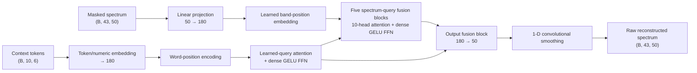

# PadSpectra dense publication model

## Public model scope

This repository contains one PadSpectra model: `flexible_pure_dense_ffn`, the
dense feed-forward configuration used for the final results. The public code
does not expose alternative neural architectures or training variants.

The maintained implementation is split across three files:

- [`padspecmodels_new.py`](../padspecmodels_new.py): dense model architecture
  and inference-time padding
- [`trainpadspecmodel_new.py`](../trainpadspecmodel_new.py): data loading,
  conditioning, loss, validation, EMA, checkpointing, and resumption
- [`trainpadspecmodel_uniform_mask.py`](../trainpadspecmodel_uniform_mask.py):
  the publication masking policy used for all training epochs

## Input and output contract

| Item | Shape | Meaning |
| --- | --- | --- |
| Spectrum input | `(B, 43, 50)` | 43 contiguous bands containing 50 wavelengths each |
| Context input | `(B, 10, 6)` | Ten fixed metadata/property slots with up to six tokens per slot |
| Raw prediction | `(B, 43, 50)` | Predicted values at all 2,150 modeled wavelengths |
| Missing-band mask | `(B, 43, 1)` | `True` when any input value in a band is zero |
| Completed spectrum | `(B, 43, 50)` | Predictions merged with observed input by `AutoEncoder.pad()` |

The data loader reads 2,151 spectral values. The measured or fitted 2500 nm
value is kept separately, while 350–2499 nm is reshaped into `43 × 50` for the
model.

## Dense architecture



Each 50-value spectral band is projected to the hidden width of 180 and receives
a learned band-position embedding. Missing bands stay in the attention sequence
so they can query observed wavelengths and context.

The context encoder embeds categorical tokens and standardized numerical
values. A learned query pools the tokens in each context slot. Its transformer
layer and all six spectrum-fusion layers use a two-layer dense GELU
feed-forward network. The hidden width is 180.

At each of the first five fusion blocks, the current spectrum tokens are the
queries. Current spectrum tokens plus the static context embeddings provide
keys and values. Padded context entries are masked. The final fusion block maps
each 180-dimensional spectrum token back to 50 values. Two one-dimensional
convolutions smooth the flattened output:

```text
1 channel → 45 channels, kernel 7 → GELU → 1 channel, kernel 5
```

## Runtime context

The `word_split_v2` encoding has ten fixed slots:

1. Sample type
2. Spectral type
3. Spectrometer
4. Measurement mode
5. Soil pH measured in water
6. Soil pH measured in CaCl₂ solution
7. Generic soil pH
8. Leaf water content in `g/m²`
9. Leaf mass per area in `g/m²`
10. Soil gravimetric water content in `%`

The vocabulary and numerical normalization statistics are learned only from
the predefined optimization rows and are saved in full checkpoints. Missing,
inapplicable, or unseen context values are represented by the padding index.
There is no unknown token.

During training, sample and spectral type are always retained. Spectrometer and
measurement mode are independently dropped with probability 0.5. Each
available numerical context property is independently retained with probability
0.5. Validation and inference use the available context without stochastic
dropout.

## Publication masking policy

The same artificial masking distribution is used throughout training:

- Alternate the primary missing edge between the low- and high-wavelength end.
- Mask 1–29 complete 50 nm bands at that edge.
- With probability 0.5, mask 1–12 bands at the opposite edge.
- Every fifth batch, also mask one contiguous 1–12-band interior block.
- Apply the sampled pattern to the complete batch.
- Retain samples with at least eight complete observed bands.

Up to 16 attempts are made to obtain a usable augmented batch with more missing
values than the original input.

## Objective

The final model is trained only for spectral reconstruction. It does not train
an auxiliary neural property predictor.

\[
\mathcal{L}_{\text{spectral}}
=
\mathcal{L}_{\text{reconstruction}}
+ 2\mathcal{L}_{\text{smoothness}}
+ \mathcal{L}_{\text{negative}}.
\]

Reconstruction MAE is computed only where artificial masking hides a positive
measured target. The smoothness term penalizes squared first differences near
masked regions, and the negative-value term penalizes negative reconstructed
values.

## Training configuration

| Setting | Publication value |
| --- | --- |
| Model | `flexible_pure_dense_ffn` |
| Context encoding | `word_split_v2` |
| Optimizer | Adam |
| Initial learning rate | `3e-4` |
| Batch size | `3500` |
| Hidden width | `180` |
| Training end | Epoch `10,000` |
| Warmup | `500` successful optimizer steps |
| Schedule | Hold through epoch 2,000; cosine to `3e-5` at epoch 9,000; continuation cosine to `1e-5` at epoch 10,000 |
| Gradient clipping | Norm `1.0` |
| Mixed precision | Enabled on CUDA |
| EMA decay | `0.99` |
| EMA update | Every five successful optimizer steps |
| Validation interval | Every ten epochs |
| Default seed | `20260804` |

The predefined train, validation, and test indices are used verbatim. The
trainer checks partition sizes, bounds, uniqueness, disjointness, and complete
row coverage. Validation rows never receive gradient updates, and test rows are
not used during training or checkpoint selection.

The primary checkpoint criterion is EMA masked-reconstruction MAE. Full-state
checkpoints contain the model, EMA model, optimizer, scheduler, gradient scaler,
random-generator states, split metadata, context vocabulary, normalization
statistics, and loss history. Set `PADSPECTRA_RESUME_CHECKPOINT` to resume a
matching run.

## Data compatibility

The trainer expects these external artifacts below `Data/` or the directory
selected by `PADSPECTRA_DATA_DIR`:

| Artifact | Relevant content |
| --- | --- |
| `spectra.h5` | Aligned 350–2500 nm spectra |
| `metadata.json` | Row-aligned context and property measurements |
| `split_indices.json` | Predefined train/validation/test indices and audits |
| `processing_manifest.json` | Frozen preprocessing profile and retained-property invariant |
| `target_schema.json` | Canonical property and unit definitions |

The complete datasets and trained checkpoints are intentionally not stored in
Git, and no pretrained checkpoint is currently published. The trained weights
are planned for release after acceptance of the associated paper.
`Data/examples/` contains a small de-identified Gemini sample for input
inspection and demos.

## Known limitations

- Missing-band detection uses the numerical value zero rather than a separate
  availability mask.
- Artificial masks are sampled per batch rather than per spectrum.
- The inference-time neighborhood mask can fail for an isolated one-band gap.
- The validation partition is in-distribution; source-held-out performance must
  be measured on the predefined test partition.
- Reconstruction on artificially hidden measured regions remains necessary to
  assess physical fidelity in wavelength regions that are naturally absent.
